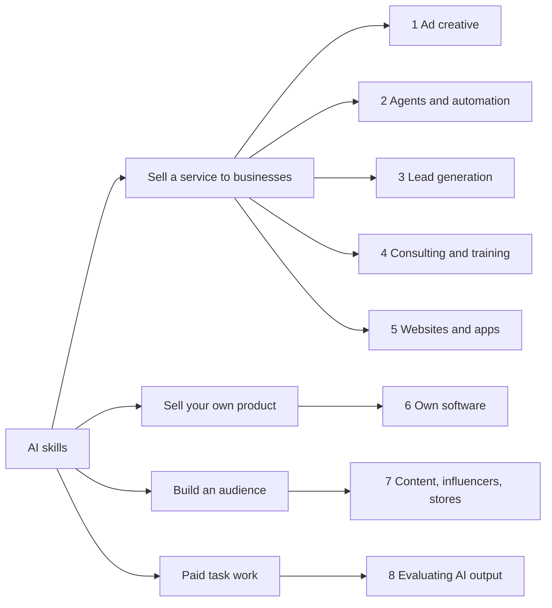

# AI income paths

Researched 2026-10-11 from the 37 videos in the `clearpieceview` YouTube playlist. This file sorts what those videos say into eight paths, records the evidence each one gives, and ends with one recommended path.

- Transcripts: `~/obsedian linux/Clippings/YouTube/clearpieceview/`, one note per video in seven folders, with an `Index` note.
- For video-only business models researched from the web, see `VIDEO_BUSINESS_MODELS.md`. This file is wider (any way to earn with AI) and its only source is the playlist.
- A video is cited as `#15 [6:59]`: video 15 in the list at the end, at 6 minutes 59 seconds.

## How to read the evidence

Every number below is what the person in the video says. None is independently checked.

| Grade | Meaning |
|---|---|
| Shown | The video walks through the result as it happens: the outreach count, the sales call, the payment. I read transcripts and did not watch the pictures, so "shown" means the speaker says it is on screen. |
| Claimed | The speaker states their own result with no detail. |
| Third-party | The speaker reports someone else's income. |

Two things lower trust across the whole playlist:

- Most of these channels earn from the tools they recommend (affiliate links and sponsors) or from their own course or community. They gain when the method sounds easy.
- 13 of the 37 videos are from one channel (Albert Olgaard), which sells an AI community.

## The eight paths

| # | Path | Who pays | Price said in the videos | Best result evidence | Fit for you *(judgment)* |
|---|---|---|---|---|---|
| 1 | AI ad creative: image and video ads for brands | Consumer brands that run paid ads | India: ₹30,000 for 10 images + 5 videos; ₹35,000 to ₹50,000 for 10 to 15 videos. High end: $25,000 to $50,000 per ad (third-party) | Shown: two small Indian sales (#29, #31) | High |
| 2 | AI agents and automation: phone, chat and back-office agents | Local and mid-size businesses | $500 to $1,500 a month; $3,000 to $5,000 per build; ₹30,000 to ₹40,000 per client a month | Claimed and third-party only | Medium |
| 3 | Lead generation: lists and cold outreach for a business | Any business that needs customers | $1,000 to $5,000 a month | Shown: reply numbers for the maker's own campaign (#12). No client sale shown | High |
| 4 | AI consulting and training | Companies with a training budget | $200 to $500 one-to-one; $2,500 to $10,000 team setup; $5,000 audit | Claimed only | Low now |
| 5 | Websites, landing pages and apps built with AI | Local businesses, coaches, agencies | $100 to $500 per site; $500 to $8,000 per app | Claimed only | Medium |
| 6 | Own software product | App users on a subscription | $9 to $19 a month per user | Shown: 4 trial sign-ups at launch (#05) | Low |
| 7 | Content, AI influencers, online stores | Viewers, through affiliate links and products | $1 per 1,000 views for clips; $12 digital product | Shown: $94 in 30 days (#21); $157 in 7 days (#16) | Low |
| 8 | Paid task work: judging AI answers | AI labs, through a platform | From about $35 an hour | Third-party only | Low |

Rupee conversions use ₹96.87 to the US dollar (exchangerate-api.com, 10 Oct 2026). ₹30,000 is about $310 and ₹50,000 about $516.

## Path 1: AI ad creative

You make image and video ads for brands with AI tools and sell them as a monthly package.

- **Seller in India, test 1 (#29).** Offer: 10 videos for ₹50,000. Contacted 200 jewellery brands on Instagram and WhatsApp: 156 no reply, 38 said no, 6 interested [10:23]. On the recorded call the buyer said his agency charges ₹40,000 for running his ads plus 10 videos, and countered at ₹35,000 for 10 videos, then 15 videos for ₹50,000 from month two [12:29 to 14:35]. No payment is shown. The maker runs a social media company and pitched under a different identity.
- **Seller in India, test 2 (#31).** Offer: 10 image ads and 5 video ads for ₹30,000 a month. Sent 400+ cold emails, 3 positive replies, made 3 sample ads, 1 paid [8:12]. The paying brand was run by someone he already knew a little. Stated cost to make the package: ₹1,000 to ₹3,000.
- **High end (#17 [5:25]).** One named maker is said to charge $25,000 to $50,000 per ad at a cost of about $2,000. Third-party.
- **How the ads are made (#26, #27, #30, #33).** Phone photos of the product, a product sheet, scene prompts written by Claude, then several 30-second generations cut together in an editor. #26 counts 12 to 26 images and 4 to 8 video generations per finished ad, about 2 hours.
- **What the buyer cared about (#29 [12:29]).** The product looked exactly like the real one. He said other AI ads change the product's design.
- **Warning from inside the playlist (#17 [5:25]).** "Don't sell AI video ads as a commodity": TikTok, Amazon and Meta make basic ones free inside their ad tools. The paid work is taste and ideas.
- **Limits of the tools (#11).** A full launch video in one generation is not ready yet; you generate scenes and cut the good ones together.

## Path 2: AI agents and automation

You set up an AI agent that does one job for a business: answers the phone, replies on chat, files receipts, chases leads.

- **Ranking (#15).** Agent development is his top pick; phone agents are second tier at $500 to $1,500 a month; chat agents sit below phone agents. He says agent development "needs more technical experience, which keeps most people out" [13:43].
- **Prices (#17).** Phone agent: $3,000 to $5,000 per build, running cost 13 to 30 cents a minute [1:40]. Back-office automation: $1,000 to $2,000 a month [4:20]. Bookkeeping: $1,500 to $3,000 a month per client [12:05].
- **Indian mid-size businesses (#19).** Says ₹30,000 to ₹40,000 per client a month; advises starting at ₹40,000 plus ₹15,000 a month maintenance [5:25].
- **How long a sale takes (#19 [9:01]).** One month of outreach, one month to convince, 15 days to build, 15 days of feedback, and the invoice is paid after 45 days. He says the big deals close face to face.
- **Learning time (#19 [1:23]).** 60 to 70 hours for the basics and 30 to 40 hours for a portfolio.

## Path 3: Lead generation

You find a business's future customers and hand over a list, or run the cold outreach for them.

- **Ranking (#15 [2:46]).** Top tier, because "you're selling money".
- **Price (#17 [10:11]).** $1,000 to $5,000 a month; tools are Clay and Apollo.
- **Mechanics (#12).** Claude connected to Instantly writes and runs the campaign. Pre-warmed inboxes, leads at $0.005 each. His own campaign: 278 leads contacted, 5.1% replied, 6 interested [0:00, 7:36].
- **Country effect (#12 [7:36]).** That campaign was in Danish. He expects about 0.5% replies in the US and 5 to 10% in small-language countries.

## Path 4: AI consulting and training

You audit how a company works, or set up ChatGPT or Claude for a person or team.

- **Ranking (#15 [6:59]).** Top tier: $5,000 audit that can become a $50,000 project. He adds it suits people with experience in the industry.
- **Prices (#17).** One-to-one setup $200 to $500; team setup $500 to $2,000 [6:58]; whole-company setup $2,500 to $10,000 for a few days [13:00].
- **Why this is hard at the start (#19 [7:00]).** Buyers judge the person. He advises working a job first.

## Path 5: Websites, landing pages and apps

- **Websites for local trades (#04).** An agent finds old websites, rebuilds each from a template, and sends the link through the business's own contact form. Suggested price $100, rising to $300 to $500, plus $97 a month hosting [10:56]. No sale is shown.
- **Apps (#17 [8:34]).** $500 to $2,000 for a simple app, $2,000 to $8,000 per project. "The tool gets you 80% there in an hour"; the last 20% (their calendar, their payments) "is the entire job".
- **Also listed in #18** as methods 3 and 7.

## Path 6: Own software product

- **Build and launch in one sitting (#05).** A dictation app built in about 4 hours of recording. Launch email to the waitlist: 24% opened, 12 clicked, 4 real trial sign-ups on the $19 a month plan [4:11:00]. The same video says it "might take months before you land your first client" [3:53].
- **Copy a proven app for another language (#22 [1:34]).** Find apps with known revenue on an app-data site and rebuild one for a country the original ignores. The ₹3 crore figure is in the title; the examples given are other people's apps.
- **Ranking (#15 [16:12]).** A studio that builds many products is rated below the services, as "too advanced" for most people.

## Path 7: Content, AI influencers and stores

- **Faceless YouTube, 30 days (#21 [5:52]).** 14 videos, 103 subscribers, about 4,000 views, $94 in affiliate income, 30 to 40 hours of work. He works it out at about $3 an hour.
- **AI influencer, 7 days (#16 [29:05]).** Three accounts, $99 budget, one $12 digital product. Profit $157.48. He set himself a $1,000 target and missed it.
- **Ranking (#15 [4:17]).** Faceless AI YouTube channels are bottom tier: "channels get demonetized within weeks".
- **Clipping (#18 [0:27]).** $1 per 1,000 views for cutting a creator's long videos into short ones.
- **Online store with AI ads (#09).** Store, supplier and ads set up in a few hours. No sale is shown.

## Path 8: Paid task work

- **Judging AI answers (#17 [3:11]).** Platforms such as Mercor pay from about $35 an hour, more for law or medical knowledge. Work comes in batches and is not steady.

## What the videos themselves rank low

| Idea | Why | Source |
|---|---|---|
| AI trading bots | "Everybody selling a trading bot is selling you a course" | #15 [12:04] |
| Faceless AI YouTube channels | Demonetized, no brand | #15 [4:17] |
| Dubbing as a service | YouTube gives it free to creators | #17 [5:25] |
| Basic AI video ads sold as a commodity | Ad platforms generate them free | #17 [5:25] |
| AI copywriting, content repurposing, logo design | Crowded, and the tools now do it unaided | #15 [5:59, 14:55, 19:39] |

## What several videos agree on

- **One narrow customer.** "Dentists with less than three locations", not "small businesses" (#14 [4:06], #15, #17 [11:11], #19).
- **Show a sample before asking for money.** A demo, a rebuilt website, a sample ad (#04, #12, #29, #31).
- **A paid order is the only proof of demand** (#14 [1:53], #15 [22:37]).
- **Sell the result, not the AI** (#19 [5:25]).
- **Cold outreach converts at about 1 to 3%.**

| Video | Contacted | Interested | Paid |
|---|---|---|---|
| #29 jewellery brands, India | 200 | 6 | 0 shown (1 agreed on a call) |
| #31 health and beauty brands, India | 400+ | 3 | 1 |
| #12 own agency, Denmark | 278 | 6 | not stated |

## Rules that can end this

- **Fake customer reviews.** #10, #32 and #34 teach "AI UGC" ads in which an invented person praises a product. In the US this falls under the fake reviews rule described in `VIDEO_BUSINESS_MODELS.md`. Ads that show the product without a fake customer are not affected.
- **False opening lines.** The cold message in #29 says "I ordered a gift for my sister from your store" (about 10:00). It was a made-up line. Do not copy it.
- **AI labels.** #09 [9:57] notes some countries require an AI label on such ads. Not checked here; check the ad platform's official page before running an ad.

## Recommendation *(judgment)*

**Sell AI ad creative (path 1) to consumer brands in the US and UK, and use the lead-generation method (path 3) to find them.**

- It is the only path where the playlist shows cold outreach turning into an agreed or paid client within days.
- The product is a file. The client does not need you to keep a system running, which suits directing AI rather than hand-building.
- The same package that sells for about $310 to $520 in India is priced at $150 to $600 per ad in the web research in `VIDEO_BUSINESS_MODELS.md`.
- Outreach scales with hours, and you have many.
- The risk is the one #17 names: basic AI ads are becoming free. The answer is one product category, ads that keep the product exact, and ideas taken from ads already running for months.

Second choice: lead generation as its own service, once you have run it for yourself.

Not first: agents and automation (2 to 3 month sales cycle, face-to-face closing, and someone must fix what breaks), own software and content (consumer income, slow, weak results in the playlist).

### First 30 days

| Week | Do | Done when |
|---|---|---|
| 1 | Pick one product category. In the Meta Ad Library, find ads that have run 2 to 3 months (#29 [2:00] treats that as a sign they pay). Recreate 6 of them with AI for a portfolio. | 6 ads you would show a buyer |
| 2 | List 500 US and UK brands in that category that are running ads now, with the founder's or marketer's email (#31 [2:00]). | 500 rows |
| 3 to 4 | Send 50 to 100 messages a day. Make a sample ad only for brands that reply (#31). Reply within the hour (#12). | 10 conversations, 1 paid pilot |

At the 1 to 3% rate above, 500 contacts give about 5 to 15 interested replies.

## Limits of this analysis

- #01 (10 hours) has no captions on YouTube and was not analysed.
- 13 videos were read in full, 5 in their key sections, and the rest searched for prices and results only. The list below says which.
- Captions are auto-generated. Tool and model names are spelled as the captions give them and may be wrong.
- Five videos have Hindi captions (#28, #29, #31, #35, #36). #29 and #31 were read in the original.
- Nothing was checked outside the videos except the exchange rate.

## Video list

| # | Channel | Title | Length | Folder | Read |
|---|---|---|---|---|---|
| 1 | Albert Olgaard | [Beginner to First Million with AI in 2026 (10+ Hours)](https://www.youtube.com/watch?v=UJtjPXpuOcY) | 10:42:33 | 1 Ways to earn - overviews | Not analysed (no captions) |
| 2 | Albert Olgaard | [I Fired my Video Editor... and Hired Claude Instead (RAW RESULTS)](https://www.youtube.com/watch?v=68v_T0jrysM) | 5:57 | 6 Own content and stores | Prices and results only |
| 3 | Albert Olgaard | [How to Create 30 Days of Content in under 60 minutes Using AI](https://www.youtube.com/watch?v=e2EgglFl7MQ) | 5:24 | 6 Own content and stores | Prices and results only |
| 4 | Albert Olgaard | [Laziest Way to Make Money with AI (For Beginners)](https://www.youtube.com/watch?v=OW8xAIGlDBE) | 18:29 | 5 Getting clients and marketing | Full |
| 5 | Albert Olgaard | [Watch me start & sell AI Software in 4 hours](https://www.youtube.com/watch?v=XDbf83iq9IY) | 4:15:07 | 4 AI software and apps | Key sections |
| 6 | Albert Olgaard | [I tested the FREE version of JEV... and it's insane](https://www.youtube.com/watch?v=sEPh5er9Ixo) | 8:28 | 7 Tools and workflows | Prices and results only |
| 7 | Albert Olgaard | [JEV Finally Solved AI Video Editing (Full guide)](https://www.youtube.com/watch?v=ZlICPWwgmmg) | 6:00 | 7 Tools and workflows | Prices and results only |
| 8 | Albert Olgaard | [I tested the new JEV Model... and it's insane](https://www.youtube.com/watch?v=_mJtnizZjNY) | 8:21 | 7 Tools and workflows | Prices and results only |
| 9 | Albert Olgaard | [How to Start a 1-Person Online Business with Claude](https://www.youtube.com/watch?v=o9BSz05wvjg) | 12:02 | 6 Own content and stores | Full |
| 10 | Albert Olgaard | [I tested Fake AI ads... and I can't even tell the difference](https://www.youtube.com/watch?v=nOb5dRina9o) | 8:29 | 2 AI ads as a service | Full |
| 11 | Albert Olgaard | [I told AI to make me a $10K video (it actually worked)](https://www.youtube.com/watch?v=iQRm8HfOeb8) | 8:57 | 2 AI ads as a service | Full |
| 12 | Albert Olgaard | [I told Claude to find me clients... and it's better than me (5% reply rate)](https://www.youtube.com/watch?v=U0sENHLLws8) | 9:38 | 5 Getting clients and marketing | Full |
| 13 | Albert Olgaard | [Higgsfield MCP + Claude = Insane Videos](https://www.youtube.com/watch?v=WiVjjGNFoMM) | 6:15 | 2 AI ads as a service | Prices and results only |
| 14 | Sandeep Swadia | [The Easiest Ways To Make Money With AI in 2026](https://www.youtube.com/watch?v=WPTAr14wmco) | 17:55 | 1 Ways to earn - overviews | Full |
| 15 | Dan Martell | [The Only 14 Ways to Make Money with AI in 2026](https://www.youtube.com/watch?v=K8Ros5RhJW4) | 26:44 | 1 Ways to earn - overviews | Full |
| 16 | Mark Tilbury | [I Tried The LAZIEST Way to Make Money With AI](https://www.youtube.com/watch?v=LlhTEttKcwQ) | 33:19 | 3 AI UGC and AI influencers | Key sections |
| 17 | Vaibhav Sisinty | [10 Ways to Get Monthly Income (let AI work for you)](https://www.youtube.com/watch?v=XtwTjwUZSTs) | 14:54 | 1 Ways to earn - overviews | Full |
| 18 | Mark Tilbury | [Laziest Ways to Make Money with AI (For Beginners)](https://www.youtube.com/watch?v=ytAW1_g2IfI) | 25:22 | 1 Ways to earn - overviews | Key sections |
| 19 | The Cutting Edge School | [How to Make Money with AI (Even If You're a Beginner)](https://www.youtube.com/watch?v=lRuVKbdLbKE) | 13:53 | 1 Ways to earn - overviews | Full |
| 20 | Sources Podcast | [Mark Zuckerberg on how Meta's Muse AI agent will make people money](https://www.youtube.com/watch?v=Lx8lrn-cytc) | 1:10:10 | 1 Ways to earn - overviews | Key sections |
| 21 | Stickman Matt | [I Tried Faceless YouTube Automation for 30 Days Realistic Results](https://www.youtube.com/watch?v=2n2P-rpql34) | 10:25 | 6 Own content and stores | Full |
| 22 | Sanskar Goyal | [How This 26 Yr Old Made ₹3 Crores with AI Apps - Vibe Coding - Claude Code - #257 The Sanskar Show](https://www.youtube.com/watch?v=aaVzqAtliUE) | 1:10:40 | 4 AI software and apps | Key sections |
| 23 | The Next New Thing | [This week’s repos: PS5 game on a PC! Turn agents into employees. AI video maker.](https://www.youtube.com/watch?v=Wsru44p-J14) | 23:47 | 7 Tools and workflows | Prices and results only |
| 24 | Vaibhav Sisinty | [You Are Making AI Videos the Hard Way. This Is the New Workflow](https://www.youtube.com/watch?v=6pG3vAbriWo) | 17:04 | 7 Tools and workflows | Prices and results only |
| 25 | Vaibhav Sisinty | [Nothing In This Video Was Filmed. One AI Agent Made It All. (Full Workflow)](https://www.youtube.com/watch?v=1kvmZZ8peBQ) | 12:59 | 7 Tools and workflows | Prices and results only |
| 26 | Rachit Singh | [How I Make AI Product Ads That Brands Actually Pay For](https://www.youtube.com/watch?v=jWdDFadnkKk) | 13:30 | 2 AI ads as a service | Full |
| 27 | Dan Kieft | [Create Cinematic AI Ads with Seedance 2.5 - Full guide](https://www.youtube.com/watch?v=kGku3TTiYO8) | 16:56 | 2 AI ads as a service | Prices and results only |
| 28 | Raj Photo Editing and Much More | [Create AI Ads for FREE* 🤯 Turn Any Product Into a Video Ad 🔥 Google Flow CODES #ai #aivideo](https://www.youtube.com/watch?v=fR6EgmfmXjk) | 8:25 | 2 AI ads as a service | Prices and results only |
| 29 | Ayushman Pandita | [I Tried Selling AI Ads To Jewellery Businesses](https://www.youtube.com/watch?v=8s5fIvyNFAo) | 17:39 | 2 AI ads as a service | Full |
| 30 | Dan Kieft | [How To Create Cinematic AI Ads - Full AI Video Course](https://www.youtube.com/watch?v=sMNjQ2Gks_4) | 16:19 | 2 AI ads as a service | Prices and results only |
| 31 | Shivansh B. | [I Turned ₹120 into ₹30,000 Selling AI ADS using Higgsfield API](https://www.youtube.com/watch?v=68oj8Un3IRM) | 10:10 | 2 AI ads as a service | Full |
| 32 | Youri van Hofwegen | [How to Make Realistic UGC Ads with AI (Full Course)](https://www.youtube.com/watch?v=eoSCoD--npk) | 11:06 | 3 AI UGC and AI influencers | Prices and results only |
| 33 | Higgsfield AI | [3-Step Workflow To Make Ultra-Realistic AI Ads](https://www.youtube.com/watch?v=3rDs6FhFoUQ) | 35:37 | 2 AI ads as a service | Prices and results only |
| 34 | Miko | [The Ultimate AI UGC Masterclass (FULL COURSE)](https://www.youtube.com/watch?v=yzQK1ETtka4) | 59:58 | 3 AI UGC and AI influencers | Prices and results only |
| 35 | WsCube Tech | [Google Ads Full Course 2026 (With AI) – Beginner to PRO in One Video](https://www.youtube.com/watch?v=autzRHtt-RM) | 1:48:35 | 5 Getting clients and marketing | Chapter titles only |
| 36 | Damini Tripathi | [Master Claude For Marketing in 20 Mins* - 2026 Full Guide 🔥](https://www.youtube.com/watch?v=e_apbxTjvrU) | 17:24 | 5 Getting clients and marketing | Prices and results only |
| 37 | pixaroma | [ComfyUI Course - Learn ComfyUI From Scratch - Full 5 Hour Course (Ep01)](https://www.youtube.com/watch?v=HkoRkNLWQzY) | 4:49:00 | 7 Tools and workflows | Chapter titles only |
