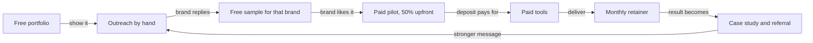

# Plan: $1,000 a month, with nothing spent first

Written 12 Oct 2026. Status: **proposed**. It builds on the path recommended in [AI_INCOME_PATHS.md](AI_INCOME_PATHS.md) (AI ad creative for US and UK consumer brands), which the founder has not yet confirmed.

- **Goal:** at least $1,000 received every month.
- **Rule:** no money is spent before money is earned. After the first payment, spending comes only out of money already received.
- **What this plan is:** a judgment built on the evidence in `AI_INCOME_PATHS.md`. That evidence is two small sales tests inside India. Selling to the US and UK from India is untested. Nothing here is a promise of income.

## The system

The deposit is what makes the rule workable: the client's first payment arrives before the first tool is bought.

## The numbers

| Item | Number | Where it comes from |
|---|---|---|
| Floor | $1,000 a month | The goal |
| Booked target | $1,500 a month | *Judgment.* With exactly $1,000 booked, one lost client breaks the floor |
| Retainer price | $500 a month for a fixed pack of ads | *Judgment.* India test sold 10 images + 5 videos for about $310 (#31). Vendor blogs list $150 to $600 per ad (`VIDEO_BUSINESS_MODELS.md`, method 1) |
| Clients needed | 3 | $1,500 / $500 |
| Contacts per paid client | About 400 to 500 | #31: 400+ emails, 3 positive, 1 paid. #29: 200 contacted, 6 interested, none shown paying |
| Contacts for 3 clients | About 1,200 to 1,500 | The row above, times 3 |
| Days of sending | 24 to 30 at 50 a day | The row above. US replies may be lower: #12 expects about 0.5% there, which would double this |

## How each need is met without spending

| Need | Free way | Bought later, from revenue |
|---|---|---|
| Making ads | Free credits on image and video tools. Start with image ads. `[UNVERIFIED]` which free plans allow client work and export without a watermark: read each tool's pricing page on day 1 | A paid plan after the first deposit. #31 puts the cost of one package at ₹1,000 to ₹3,000 |
| Finding brands | Meta Ad Library and the brands' own sites, searched by hand | Lead tools |
| Outreach | Your own email, Instagram, LinkedIn and each brand's contact form, at a volume low enough not to be blocked. `[UNVERIFIED]` the daily limits: check each platform | Sending domains and inboxes (the #12 method) |
| Showing work | A shared folder or a free page | A domain |
| Getting paid | An invoice for 50% before work starts, through a provider that takes its fee out of the payment. `[UNVERIFIED]` fees and India rules: check the provider's official page | |
| Thinking and writing | The Claude plan already paid for. Nothing new is bought | |

## Short-term plan: first 90 days

| When | Do | Done when |
|---|---|---|
| Days 1 to 3 | Pick one product category. Make 1 image ad and 1 video ad of a real product with free tools only | You know what you can make for nothing. If free video is not good enough to sell, sell image ads until the first deposit |
| Days 4 to 10 | In the Meta Ad Library, find ads in the category that have run 2 to 3 months (#29). Recreate 6 as a portfolio | 6 ads you would show a buyer |
| Days 4 to 14 | List 500 US and UK brands in the category that run ads now, with the founder's or marketer's contact (#31) | 500 rows |
| Days 11 to 40 | Send 50 messages a day by hand. Make a sample only for brands that reply (#31). Reply within the hour (#12). Ask for 50% upfront | 10 conversations and 1 paid pilot |
| Days 41 to 90 | Deliver the pilot. Offer the monthly pack. Buy the first tool from the deposit. Keep sending 50 a day | $1,000 received inside one calendar month |

### When to change course

| After | With | Do |
|---|---|---|
| 500 contacts | No interested reply | Change the message and the portfolio, not the path |
| 1,000 contacts | No paid pilot | Change the product category |
| 1,500 contacts | No paid pilot | Stop this path and reopen `AI_INCOME_PATHS.md`. Second choice there is lead generation |

## Long-term plan: months 4 to 12

| When | Do | Done when |
|---|---|---|
| Months 4 to 6 | Make the floor safe: 3 or more retainers, with a 3-month minimum term. Never stop outreach; drop it to half volume | $1,500 a month booked |
| Months 4 to 6 | Start spending, capped at 30% of last month's receipts *(judgment)*: a video tool first, then sending domains | Outreach no longer depends on hand-sending |
| Months 6 to 9 | Raise the price for new clients. Add lead generation as a second service, now that you have run it for yourself | A second service has 1 paying client |
| Months 6 to 12 | Turn client results into case studies and videos through this repo's pipeline, so leads also come in without cold outreach | 1 client came from content |
| Month 12 | Review | The floor held for 6 months in a row |

## Rules that can end this

Carried over from `AI_INCOME_PATHS.md`:

- No ad in which an invented customer praises the product.
- No made-up opening line in a cold message.
- Check the ad platform's rule on AI labels before a client runs an ad.

Not checked: tax and bank rules in India for income from foreign clients. Ask an accountant when the first payment arrives.

## Weekly log

Fill in from your own records. Do not estimate.

| Week ending | Contacts sent | Replies | Samples made | Paid pilots | Received (USD) | Spent (USD) |
|---|---|---|---|---|---|---|
| | | | | | | |
