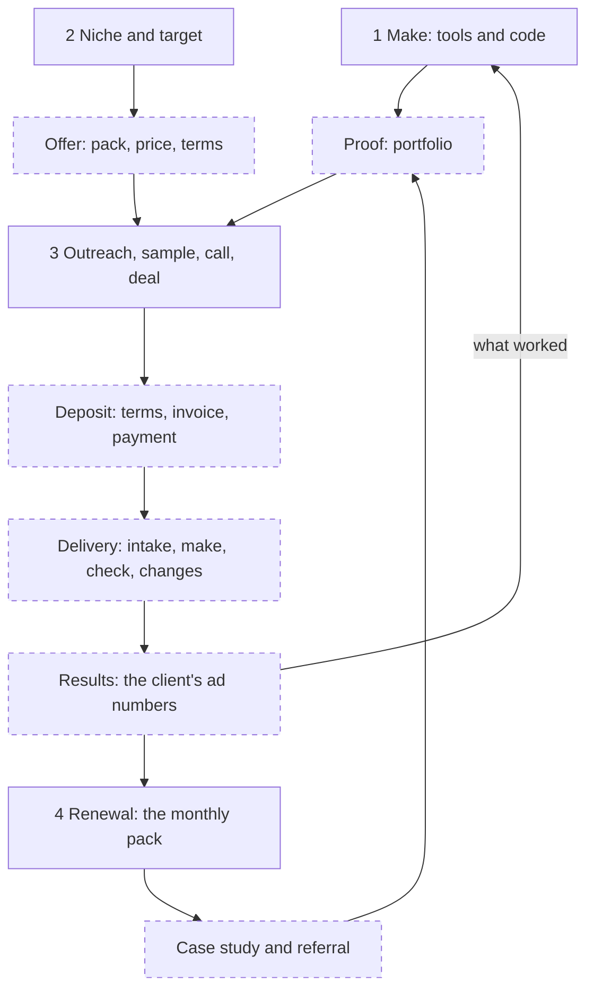

# Roadmap: the whole business, dot to dot

Written 13 Oct 2026. Status: **path and markets decided 13 Oct 2026, the rest proposed**. This file is the map: the parts of the business, the dots missing between them, and the order to do everything in.

- The numbers and the 90-day timetable stay in [PLAN.md](PLAN.md). The evidence stays in [AI_INCOME_PATHS.md](AI_INCOME_PATHS.md) and [VIDEO_BUSINESS_MODELS.md](VIDEO_BUSINESS_MODELS.md).
- A playlist video is cited as `#31`, as in `AI_INCOME_PATHS.md`. Every figure from a video is what its maker says.
- *(judgment)* marks my assessment. `[UNVERIFIED]` marks something nobody has checked yet.

## Summary

- **The business:** make image and video ads with AI for consumer brands, sell them as a monthly pack, and keep each brand for many months.
- **The goal:** at least $1,000 received every month, with nothing spent before money is earned.
- **Where it stands:** nothing has been made or sold. Decided on 13 Oct 2026: path 1 only, in five countries (Part 2). The category is not picked, and the timetable in `PLAN.md` is still proposed.
- **Your four parts are right, and they are four links out of ten.** Six links between them are missing or undefined: the offer, the proof, the deposit, delivery, results, and the case study that feeds the next sale.
- **The three biggest holes** *(judgment)*:
  1. The offer is a price with nothing behind it. You cannot quote on a call yet.
  2. Nothing covers delivering the ads or learning whether they sold. Renewal depends on both.
  3. The whole plan rests on a market nobody in the research has sold to from India.
- **Next action:** dots 1 and 3 are decided. Pick the category (dot 2), then start at dot 4.

## The full picture

Solid boxes are your four parts. Dashed boxes are the links your four parts leave out.

| Link | In your four parts | In `PLAN.md` |
|---|---|---|
| Make | Part 1 | Days 1 to 3 |
| Niche and target | Part 2 | "Pick one category", with no way to choose |
| Offer | No | Price only: $500 a month |
| Proof | No | Yes: 6 portfolio ads |
| Outreach to deal | Part 3 | Outreach yes. The call and the deal: no |
| Deposit | No | Named (50% upfront). How it is invoiced and received: unverified |
| Delivery | No | One line: "deliver the pilot" |
| Results | No | No |
| Renewal | Part 4 | Months 4 to 6 |
| Case study and referral | No | Yes, in the system diagram |

## Part 1: Make the videos

There are two ways to make a video, and they do different jobs.

| Way | What it is | Good at | Weak at | Cost |
|---|---|---|---|---|
| Generative tools | You give a prompt or a photo, and a model makes the picture or clip | Scenes, settings, motion, a product placed in a world | Keeping the product exact (#29), one long take (#11), getting the same result twice | Credits per generation |
| Code | A program draws every frame: text, photos, clips, timing. Claude can write it | Captions, prices, logos, end cards, the real product photo, many versions and sizes from one file | Anything that was never filmed or generated | The tools are free and run on the laptop `[UNVERIFIED]` |

**How they connect** *(judgment)*: generate the scenes with tools, then assemble and version them with code. Code is the free layer and the exact layer. It is also the answer to the warning in #17 that ad platforms now make basic AI ads for free: a platform does not hand a brand 10 tested versions of one idea with the product kept exact.

### Tools by job

| Job | Named in the playlist | Other known tools *(my knowledge, not the playlist)* |
|---|---|---|
| Prompts, scripts, scene plans | Claude (#26, #36) | |
| Product images and scenes | Higgsfield (#13, #31, #33), Google Flow (#28), ComfyUI (#37) | Midjourney, Flux |
| Video clips | Seedance 2.5 (#27), Higgsfield, Google Flow | Kling, Runway, Luma, Veo, Sora |
| Cutting clips together | "An editor" (#26). JEV (#06 to #08) | CapCut, DaVinci Resolve |
| Video from code | Agent-made video in #02, #23, #24, #25. Tool names were not recorded | Remotion, FFmpeg, Motion Canvas, Manim |
| Voice and music | Not recorded | ElevenLabs |

- Nothing in the right-hand column has been checked for price, free plan or licence. Check each official page first.
- Music and voices need a licence that covers client ads. Record it, as `AGENTS.md` requires.
- The six playlist videos on code and agent-made video were only searched for prices. Their transcripts are on the desktop, not this laptop.

### How an ad is made (#26, #27, #30, #33)

1. Phone photos of the product, plus a product sheet.
2. Claude writes the scene prompts.
3. Generate 12 to 26 images and 4 to 8 video clips per finished ad (#26).
4. Cut the good clips together in an editor. About 2 hours per ad (#26).

### What to learn, and when to stop

Learn by making the next thing you need, not by studying tools. *(judgment)*

| Order | Make this | Teaches |
|---|---|---|
| 1 | 1 image ad of a real product | Whether a free tool keeps the product exact |
| 2 | 1 video ad of the same product | The generate-and-cut workflow |
| 3 | 1 code template: captions, end card, each size, text versions | The free, exact layer |
| 4 | 6 portfolio ads | Speed, and your real hours per ad |

Stop there. Part 1 gets days 1 to 10 and no more. Everything after is learned on client work.

**Tools are half of this part.** #17 says the paid work is "taste and ideas". The other half is ad craft: the first two seconds, one idea per ad, and a clear next step. The free teacher is the Meta Ad Library: ads that have run 2 to 3 months are treated as ads that pay (#29).

## Part 2: Niche and who to target

`PLAN.md` says "pick one product category" and gives no way to choose. Use these six questions. *(judgment, built from the research)*

| # | Question | How to check for free | Why |
|---|---|---|---|
| 1 | Do many brands in it run paid ads now? | Search the category in the Meta Ad Library, once for each of the five countries | They already pay for ads |
| 2 | Are there 1,000 or more brands small enough that the founder answers? | Count while you search, per country | `PLAN.md` changes category only after 1,000 contacts |
| 3 | Can free tools keep this product exact? | Dot 5: make one ad and put it beside the real photo | It is what the buyer in #29 cared about most |
| 4 | Do brands here change their ads often? | Count how many different ads one brand has live | You sell new versions every month |
| 5 | Are there rules on what an ad may claim? | Read the ad platform's policy for the category `[UNVERIFIED]` | Health and skin claims may be restricted. Not checked |
| 6 | Can a brand of this size pay $500 a month? | It has run ads for 2 to 3 months (#29) | A brand that spends on ads has an ad budget |

**Who to contact:** the founder or the marketer (#31) of a brand that is running ads now.

**Who you are compared with:** the buyer in #29 already paid an agency ₹40,000 for running his ads plus 10 videos. Expect "my agency does this". Agencies can also be buyers: white-label work is a real market, with no rates found (`VIDEO_BUSINESS_MODELS.md`, method 9).

### The five countries

Decided by the founder on 13 Oct 2026: path 1 only, sold in five countries chosen by how many rupees one unit of their money buys. Which five is my pick. *(judgment)*

Rates are from exchangerate-api.com, updated 12 Oct 2026. They move every day.

| Country | Currency | Rupees for 1 unit | Language of its ads | Why it is in |
|---|---|---|---|---|
| Kuwait | Kuwaiti dinar | 308.55 | Arabic and English *(my knowledge)* | The highest rate of any country. Its working day is an Indian daytime |
| United Kingdom | Pound | 126.66 | English | English, and a large number of brands *(judgment)* |
| Switzerland | Swiss franc | 114.92 | German, French, Italian | The strongest currency in mainland Europe |
| Ireland | Euro | 106.94 | English | The English-speaking euro country. Same clock as the UK |
| United States | US dollar | 95.90 | English | The largest market *(judgment)*. Its working day is an Indian night |

**Left out, with a higher rate than the pound:** Bahrain (255.10), Oman (249.44) and Jordan (135.28). They are small markets *(judgment, not counted)*. Kuwait stands in for the Gulf: if it replies, Bahrain and Oman take the same message on the same clock. Germany, France and the Netherlands share Ireland's euro, but their ads are in their own languages.

**A strong currency does not make a sale worth more.** The rate only says how big one unit is. $500 is ₹47,950 in every one of these: 155 dinars, £379, 417 francs or €448. Two other things decide what you earn, and neither is checked:

- **The price a brand there will pay.** Strong-currency countries tend to be rich ones, which is the real reason to aim at them. *(judgment)*
- **How many brands there are.** Kuwait, Switzerland and Ireland are small countries. Expect most of the 500 rows to come from the UK and the US. *(judgment)*

**The free test:** the Meta Ad Library searches one country at a time. Run questions 1 and 2 above for each of the five, write down the count, and drop a country that has too few brands.

**The risks this adds:**

- Swiss and Kuwaiti ads may need German, French or Arabic text that you cannot check yourself.
- Cold email rules differ in each of the five. None has been read (M8).
- The clock for all five is in M10.

## Part 3: From stranger to paying client

| Step | What the research says | Source |
|---|---|---|
| List | Brands running ads now, with the founder's or marketer's contact | #31 |
| Message | One narrow customer. Sell the result, not the AI. No made-up opening line | #14, #19, #29 |
| Reply | Answer within the hour | #12 |
| Sample | Make one only for a brand that replied. 3 samples led to 1 paid client | #31 |
| Call | Not covered in `PLAN.md`. In #29 the buyer pushed ₹50,000 down to ₹35,000 | #29 |
| Deal | 50% before work starts | `PLAN.md` |

- **The numbers:** about 400 to 500 contacts for one paid client. The full table is in `PLAN.md`.
- **What the message should prove** *(judgment)*: that the product stays exact. It is the one thing the buyer in #29 named, and the sample shows it.

## Part 4: Keep the client

A brand keeps paying for one reason: the ads sell.

| What makes them stay | What it takes | Source |
|---|---|---|
| New ads every month | Each ad stops working after a while, so brands need new versions | `VIDEO_BUSINESS_MODELS.md`, method 1 |
| Proof the ads worked | Their numbers per ad. You do not have these unless you ask | Method 4 names "hard to prove the videos made money" as the risk |
| A minimum term | 3 months is common among agencies | Method 4 |
| Being reliable | A fixed delivery day and a fixed number of changes | *(judgment)* |

| How revenue grows | Source |
|---|---|
| More clients: outreach never stops | `PLAN.md` |
| A higher price for new clients | `PLAN.md`, months 6 to 9 |
| Usage rights charged on top, commonly 30 to 100% of the base price | `VIDEO_BUSINESS_MODELS.md`, method 1 |
| A bonus tied to ad results, which some agencies add | Same |
| Lead generation as a second service | `PLAN.md` |
| Referrals and case studies | `PLAN.md` |

## The missing dots

Ranked by how much damage each one does if left open. *(judgment)*

| # | Missing dot | Sits in | Why it matters | Closed by |
|---|---|---|---|---|
| M1 | The offer is only a price | Between 2 and 3 | `PLAN.md` says $500 a month for "a fixed pack". It does not say what is in the pack, what the pilot is, how many changes, how fast, or who owns the files | Dot 8 |
| M2 | Delivery has no process | Between 3 and 4 | `PIPELINE.md`, `QUALITY_BAR.md` and the templates are for channel videos: titles, thumbnails, retention. Nothing covers a client's intake, an ad check or a limit on changes | Dots 17 to 19 |
| M3 | The market is untested | Parts 2 and 3 | Both shown sales were inside India, at about $310 to $520 a month, close to the $500 planned. Nobody in the research sold from India to any of the five countries. #12 expects about 0.5% replies in the US | Dot 3 |
| M4 | No results loop | Part 4 | Renewal depends on numbers you never see | Dots 16 and 21 |
| M5 | The sales call is blank | Part 3 | `PLAN.md` jumps from "brand replies" to "paid pilot". No questions, no answer to "my agency does this", no price floor | Dot 15 |
| M6 | The category has no test | Part 2 | A wrong pick costs 1,000 contacts before the plan changes it | Dot 2 |
| M7 | Money plumbing is unchecked | Between 3 and 4 | Written terms, the invoice, receiving foreign payments in India, and tax. `PLAN.md` marks these unverified | Dot 9 |
| M8 | Outreach rules are unchecked | Part 3 | Cold email law in each of the five countries, and each platform's daily limits. The contact list is personal data and this repo is on GitHub | Dots 11 and 12 |
| M9 | Free credits may not cover the portfolio | Part 1 | At #26's counts, 6 video ads need 24 to 48 clip generations and 72 to 156 images | Dots 4 and 6 |
| M10 | Hours and the clock | All parts | See the two tables below | Dots 3 and 13 |
| M11 | Code video has no job in the plan | Part 1 | You listed it, and `PLAN.md` never uses it | Dot 6 |
| M12 | Learning has no end | Part 1 | New tools appear every month. Studying them feels like progress and sells nothing | The stop rule in part 1 |
| M13 | The strategy file says something else | Whole repo | `STRATEGY.md` still assumes an audience-first channel and its Business model row reads "Not set" | Dot 1 |

**M10, the clock.** Replies are due within the hour (#12). India is 5 hours 30 minutes ahead of UTC. Winter times, from November:

| Buyer's working day, 9:00 to 17:00 | In India |
|---|---|
| Kuwait. Its working week is Sunday to Thursday `[UNVERIFIED]` | 11:30 to 19:30 |
| Switzerland | 13:30 to 21:30 |
| UK and Ireland | 14:30 to 22:30 |
| US East Coast | 19:30 to 03:30 |
| US West Coast | 22:30 to 06:30 |

Kuwait, Switzerland, the UK and Ireland together run from 11:30 to 22:30 in India. The US adds the night.

**M10, the hours.** Time the first week and write the real figures in `PLAN.md`.

| Work | Hours | Source |
|---|---|---|
| One finished video ad | About 2 | #26 |
| 3 clients at 5 video ads each | About 30 a month, before images and changes | #26, times 15 |
| 50 messages a day by hand | Not known | Time it on day 11 |

## The plan, dot to dot

The "Plan" column shows where a dot already sits in `PLAN.md`. "New" means the plan does not have it.

### Decide (day 0)

| # | Dot | Done when | Plan |
|---|---|---|---|
| 1 | Accept or change the path | **Done 13 Oct 2026:** path 1 only. The Business model row in `STRATEGY.md` is set. The timetable in `PLAN.md` is still to accept | New |
| 2 | Pick the category with the six questions | Questions 1, 2, 4 and 6 are answered in writing. Question 3 waits for dot 5 | Days 1 to 3 |
| 3 | Pick the markets | **Done 13 Oct 2026:** the five countries in Part 2. Still open: which hours you will be awake for, and whether a first paying client in India counts | New |

*Recommendation for dot 3 (judgment):* send to the UK and Ireland first: both are English, and their working day is an Indian afternoon and evening. Add Kuwait next, then the US, then Switzerland. Let the first paying client come from anywhere, India included: a real case study is the thing the message lacks.

### Learn by making (days 1 to 10)

| # | Dot | Done when | Plan |
|---|---|---|---|
| 4 | Read each free plan's terms | For every tool: client work allowed or not, watermark or not, credits a month. Written into `PLAN.md` | Day 1 |
| 5 | Make 1 image ad and 1 video ad of a real product | Beside the real photo, the shape, colour and label match | Days 1 to 3 |
| 6 | Build the code template once | One command turns one ad into every size, with captions, an end card and 5 text versions | New |
| 7 | Make the 6-ad portfolio | 6 ads you would show a buyer, each labelled as sample work and not as client work | Days 4 to 10 |

### Set up the shop (days 4 to 14)

| # | Dot | Done when | Plan |
|---|---|---|---|
| 8 | Write the offer on one page | It states the pack, the pilot, the price and your floor, the number of changes, the delivery days, and who may use the files | New |
| 9 | Prepare terms, invoice and payment route | One page of terms, an invoice you can send in 5 minutes, and a provider whose fees and India rules you read on its official page | Unverified in the plan |
| 10 | Put the portfolio behind one link | A free page or shared folder that opens on a phone | In the plan |
| 11 | Check the outreach rules | You have read the cold email rules for each of the five countries and each platform's daily limit, and written them into `PLAN.md` | Unverified in the plan |
| 12 | List the brands | 500 rows with a contact each, in a sheet kept outside this repo | Days 4 to 14 |

*Starting point for dot 8 (judgment):* the pack #31 sold, 10 image ads and 5 video ads a month. The pilot is month one at full price, 50% before work and 50% on delivery. The terms state that video made only from prompts cannot be copyrighted (`VIDEO_BUSINESS_MODELS.md`, Rules).

### Sell (days 11 to 40)

| # | Dot | Done when | Plan |
|---|---|---|---|
| 13 | Send 50 messages a day | Each day's count is in the weekly log in `PLAN.md` | Days 11 to 40 |
| 14 | Reply within the hour and sample only for replies | Every reply got an answer inside the buyer's working day | Days 11 to 40 |
| 15 | Run the call from a sheet | You asked what ads run now, who makes them, what they cost and how many new ones are needed a month. Then you showed the sample and named the pack and price | New |
| 16 | Close | The terms are agreed in writing, they include sharing the ad numbers, and 50% has arrived before work starts | Named in the plan |

### Deliver (days 41 to 90)

| # | Dot | Done when | Plan |
|---|---|---|---|
| 17 | Intake | You hold product photos, a product sheet, the brand's rules, the sizes needed, and which of their ads work now | New |
| 18 | Make and check | Every ad passed your ad check: product exact, no invented customer, text readable on a phone, licences recorded | New |
| 19 | Deliver and change once | Files sent on the promised day, one round of changes done | One line in the plan |
| 20 | Buy the first tool | Paid for out of the deposit, and logged as spent | Days 41 to 90 |

Dots 17 and 18 need two files this repo does not have: a client brief template and an ad check list. Write them when the first pilot is agreed, not before.

### Keep and grow (day 60 onward)

| # | Dot | Done when | Plan |
|---|---|---|---|
| 21 | Get the numbers | Two weeks after the ads run, you have spend, clicks and sales per ad, and one sentence on what worked | New |
| 22 | Offer the monthly pack before the pilot ends | The client has said yes or no to a 3-month term | Months 4 to 6 in the plan. Moved earlier |
| 23 | Run the monthly rhythm | Each month: ideas taken from last month's numbers, the pack delivered, a short report sent | New |
| 24 | Ask for a case study and one referral | Written permission to show the work and the result | In the plan |
| 25 | Put the case study into the outreach message | The message opens with a real result | In the plan |
| 26 | Months 4 to 12 | As written in `PLAN.md`: 3 retainers, a price rise, a second service, content | In the plan |

The points at which to change the message, the category or the path are in `PLAN.md` under "When to change course".

## Decisions only you can make

Decided on 13 Oct 2026: path 1 only, and the five countries in Part 2. Still open:

1. The category.
2. The timetable and numbers in `PLAN.md`: accept them or change them.
3. Whether an Indian client counts as a start.
4. What is in the pack, and the lowest price you will take.
5. How many hours a day you have, and which hours.

## Not checked

- Prices, free plans and licences of every tool named here.
- Cold email law in each of the five countries, and platform sending limits.
- What brands in each of the five countries pay for ads, and how many of them run ads.
- Kuwait's working week, and which language its brands advertise in.
- Ad platform rules on AI labels and on health or skin claims.
- Payment providers, and tax and bank rules in India for foreign income. Ask an accountant when the first payment arrives.
- Whether a brand in any of the five countries will buy from a seller in India. Only selling will answer this.
