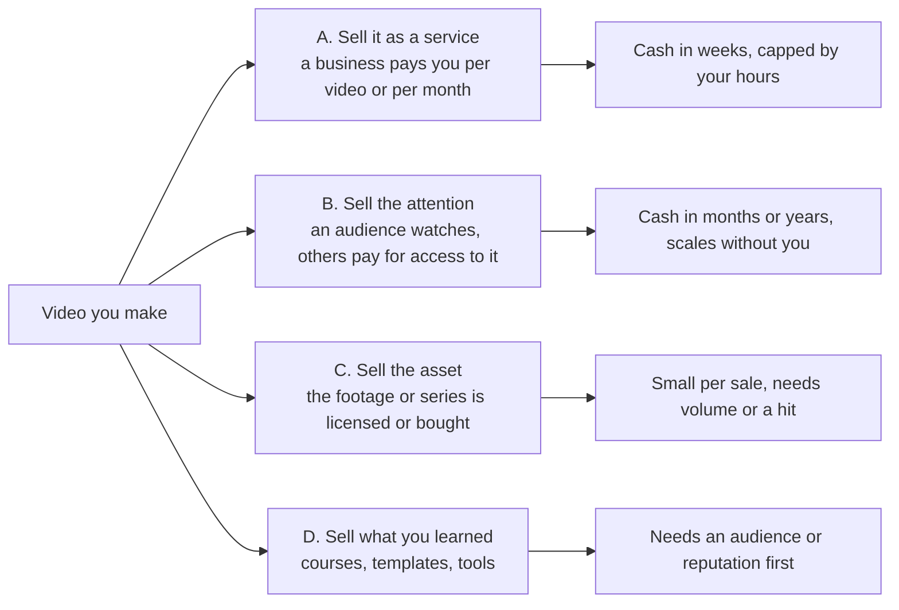

# Video business models: who earns money from video, and how

Researched 2026-10-10. This is the landscape to choose from. The choice itself goes in `STRATEGY.md` ("Business model" row); the streams a channel can run are in `MONETIZATION.md`.

## How to read the numbers

Most public figures about earning from AI video are published by people selling a tool, a course, or an agency service. Every number below carries a grade so you know how far to trust it.

| Grade | Meaning |
|---|---|
| **A** | Official platform or government page, or named reporting by an established outlet. |
| **B** | Vendor or agency blogs. Several agree, or one publishes its own price list. Useful as a range, not as a promise. |
| **C** | A seller's own income claim, or a single unsourced figure. Treat as marketing. |

"Not found" means I searched and found no usable figure. It does not mean the method does not pay.

Columns marked *(judgment)* are my assessment, not a sourced fact.

## The four ways video turns into money

The main trade-off: **services pay soonest and need no audience; audience models pay latest and scale furthest.** Most people who earn well combine two: a service for cash now, a channel that brings clients and compounds.

## All methods at a glance

| # | Method | Who does it | Who pays | Price or pay evidence | Grade | First money *(judgment)* | Main risk |
|---|---|---|---|---|---|---|---|
| **A. Service** | | | | | | | |
| 1 | AI ad creative for e-commerce and app brands (incl. "AI UGC") | Solo, small agency | Brands running paid ads | $150–600 per ad; 8–15 ad pack $1,200–4,000; retainer $1,500–5,000/mo solo, $5,000+ agency. One agency lists €200/video and €10,000/mo for 20 | B | Weeks | Fake-testimonial law (see Rules); low end is a price race |
| 2 | High-end AI commercials and brand films | AI studios, known directors | Brands, ad agencies | The Dor Brothers ~€200,000 per larger spot; Genre.ai ~$100,000 per 30-second spot; R/GA acquired the AI studio Addition | A | Months to years | Needs a reel and reputation that gets you the brief |
| 3 | Explainer, product demo, and launch videos | Freelancers, studios | SaaS and other B2B companies | Typical 60 seconds: $2,500–10,000; mid-market studio $5,000–15,000; freelancer $500–5,000 | B | Weeks | Clients compare you with $50 DIY tools |
| 4 | Short-form content retainer | Solo, small agency | Local businesses, founders, personal brands | Retainers $750–5,000/mo; one US shop lists 9 videos for $1,650/mo, 3-month minimum | B | Weeks | Churn; hard to prove the videos made money |
| 5 | Marketplace gigs (Fiverr, Upwork) | Individuals | Anyone | Fiverr lists AI video art at $45–222 fixed price; Fiverr takes 20% | A for Fiverr's own page | Days to weeks | Lowest prices, most competition |
| 6 | Music videos and visualizers | Individuals | Independent artists, labels | Indie live-action budgets $500–5,000; AI director rates not found | B / not found | Weeks | Small budgets |
| 7 | Human UGC creator (you film it, the brand posts it; no audience needed) | Individuals | Brands | $150–300 per video, median about $175; about 19% discount on bundles of 5+ | B | Weeks | Being undercut by AI versions of the same thing |
| 8 | Training, internal comms, localization and dubbing | Agencies, in-house teams | Companies | Not researched for pricing | not found | Unknown | Long sales cycles |
| 9 | White-label production for other agencies | Solo, small studio | Marketing agencies | Offered in the market; rates not found | not found | Weeks | You never own the client |
| **B. Attention** | | | | | | | |
| 10 | YouTube long-form, ad revenue | Individuals, teams, channel networks | YouTube (advertisers) | Entry: 1,000 subscribers plus 4,000 watch hours in 12 months. Estimated revenue per 1,000 views: finance $9–25, education and health $8–18, entertainment $2–4 | A for entry, B for revenue | 6–18 months | Demonetization of repetitive AI content; slow start |
| 11 | Shorts, Reels, TikTok payouts | Individuals | The platform | Shorts estimated $0.04–0.40 per 1,000 views. TikTok Creator Rewards: 10,000 followers, 100,000 views in 30 days, videos over 1 minute, limited country list. Facebook: invite-only | B | Months | Pays least per view; country limits |
| 12 | Sponsorships | Channels with a defined audience | Brands | Depends on niche and proof of audience; no reliable public rate | not found | After an audience exists | Lumpy income |
| 13 | Affiliate and shoppable video (incl. TikTok Shop) | Individuals, teams | Sellers, per sale | Commission typically 10–25% of order value, set by seller. US TikTok Shop sales about $15.82B in 2025 | B | First video that converts | Paid per sale, not per view; depends on product choice |
| 14 | Clipping (cutting someone else's long content into shorts, paid per view) | Individuals, clip teams | Creators and brands, through marketplaces | Mostly $0.50–1.50 per 1,000 views; beginners estimated $100–500/mo. One platform reported paying over $40,000 a day in total | B | Days | Budgets run out; account bans; not your own asset |
| 15 | AI persona or virtual influencer | Individuals, small agencies | Subscribers, brands | Documented range about $2,500/mo for a small operator to about $23,000 in a top persona's best month. Fanvue takes 20% | B, with many C claims around it | Months | Platforms flag AI accounts as unoriginal; much of this market is adult content |
| **C. Asset** | | | | | | | |
| 16 | Stock footage | Individuals | Stock sites' customers | Adobe Stock accepts generative AI video if labeled as such; earnings not found | A for the rule | Months | Crowded; other sites' AI rules not checked |
| 17 | Licensing real footage as AI training data | Creators with large archives | AI companies, via brokers | $1–4 per minute, more for 4K and drone; buyers often want about 1,000 hours. Reported Jan 2025, not re-verified | A, but dated | One-off | Needs a large archive of real, unused footage |
| 18 | Original series (microdramas, short films, IP) | Studios, teams | Apps, viewers | Market about $11B in 2025 (Omdia). Platforms reported to buy a 60–90 episode series for $150,000–250,000 | A for market, B for deal size | A year or more | Distribution costs more than production |
| **D. Knowledge** | | | | | | | |
| 19 | Courses, paid communities, prompt and template packs | People with an audience or a visible track record | Other creators | One AI video community charges $9/mo and claims 25,000+ members. No independent revenue data | C | After an audience exists | Selling the dream instead of a result; trust |
| 20 | Building a video tool or automation | Founders, developers | Creators, agencies | Not researched | not found | Months | A software business, not a video business |

## Details by method

### A. Selling video as a service

**1. AI ad creative for e-commerce and app brands.** Brands that buy ads need many new ad variations every month, because each ad stops working after a while. You sell the variations. Sold three ways: per video, as a test pack, or as a monthly retainer. Sources recommend retainers for brands that need 20 or more new ads a month. Some agencies add a bonus tied to ad results. Usage rights are charged on top, commonly 30–100% of the base price. This is the method with the most visible buyers and the clearest pricing right now. All pricing here is from vendor and agency blogs.

**2. High-end AI commercials.** The best-documented money in AI video. Semafor (Sept 2025) reported The Dor Brothers charging about €200,000 for larger spots, and Genre.ai about $100,000 for a 30-second commercial; its founder said one ad took two days. Clients named include eToro and Kalshi. Wonder Studios raised $12 million. These buyers pay for taste and a known name, so this is a destination, not a starting point.

**3. Explainer, demo, and launch videos.** An old, steady market. Companies already expect to pay thousands for 60 seconds. AI lowers your cost; it does not have to lower your price if the result is as good. Motion-graphics style, the one most used for software, is listed at $5,000–15,000 from agencies and $1,500–4,000 from freelancers.

**4. Short-form retainers.** A business pays monthly for a fixed number of short videos. Easy to sell to local businesses and founders who know they should post and do not. Most agencies ask for a 3-month minimum.

**5. Marketplace gigs.** Fastest way to get a first paying customer and a first review. Poor place to stay: Fiverr's own guide shows $45–222 per job before its 20% cut.

**6. Music videos.** Artists need visuals for every release and have little money. Works as a portfolio builder and a niche; I found no reliable rates for AI-made videos.

**7. Human UGC.** A person films a product video; the brand runs it as an ad on its own account. No audience needed. Included because it is the human version of method 1 and sets the price brands compare against.

**8 and 9.** Real markets I did not find pricing for. Research before choosing either.

### B. Selling attention

**10. YouTube long-form.** Checked on YouTube's own help page today: 1,000 subscribers plus either 4,000 watch hours in the last 12 months or 10 million Shorts views in the last 90 days. YouTube says updated program terms start 2027-02-01 and must be accepted by 2027-01-31. One third-party guide claims the entry bar rises to 8,000 hours on that date; YouTube's page does not say that. `[UNVERIFIED]`

The policy that matters for AI video: since 2025-07-15 YouTube does not pay for "inauthentic content", meaning mass-produced or repetitive videos, such as slideshows with the same narration or stories that differ only superficially. AI is allowed when the video adds real original commentary, editing, or value. A July 2026 report says this was tightened again for repetitive AI videos and AI avatars on sensitive topics (single source).

Revenue per 1,000 views varies about tenfold by topic. All per-niche figures are third-party estimates; YouTube publishes none.

**11. Short-form payouts.** The lowest pay per view of any method here. Useful for reach, weak as the business. TikTok's program is limited to certain countries; check the in-app list for yours. Facebook's program is invite-only.

**12. Sponsorships.** Start once a channel has a consistent audience in a niche where sponsors already pay creators. No trustworthy public rate card exists.

**13. Affiliate and shoppable video.** You earn a share of each sale, so a small video that converts beats a large one that does not. Can start with the first video. On TikTok Shop the seller sets the commission. No verified "average creator earnings" figure exists.

**14. Clipping.** Creators and brands post a budget; you cut their long videos into shorts, post them on your accounts, and get paid per 1,000 views. Real, fast, low paid. People who earn from it run several accounts and post daily. Rates are from clipping-tool vendors.

**15. AI personas.** A generated character with its own accounts, earning from subscriptions and brand posts. Independent analysis puts typical operators at a few thousand dollars a month; larger claims come from the platform or from course sellers. One survey cited found 31% of consumers trust a brand less when they notice AI in its marketing, against 7% more.

### C. Selling the asset

**16. Stock footage.** Adobe Stock accepts AI-generated video. You must mark it as AI-generated, cannot use real people's or artists' names in titles, and need a release for any recognizable person. I found no earnings data.

**17. Training-data licensing.** AI companies pay creators for unused real footage through brokers such as Troveo, which said it had paid creators over $5 million as of January 2025. Only relevant with a large archive of camera footage.

**18. Original series.** Microdrama apps are a large market: DramaBox and ReelShort each took close to $140 million in in-app purchases in Q1 2026 (Sensor Tower). The stated bottleneck is distribution cost, not production cost. I found no verified cost figures for AI-made series.

### D. Selling knowledge

**19. Courses and communities.** Widely sold. Every income figure I found came from the seller. Works only after you have a result worth teaching and people who know it.

**20. Tools.** Out of scope for this research.

## Rules that can end any of these

| Rule | What it means for you | Grade |
|---|---|---|
| FTC fake reviews rule (US, effective 2024-10-21) | A testimonial from a person who does not exist, or who did not use the product, is illegal, and the rule names AI-generated ones. Penalties are about $51,744 per violation. An "AI UGC" ad showing a fake customer praising a product is exactly this. AI ads that demonstrate a product without pretending to be a customer are not. | A |
| YouTube inauthentic content policy | Templated, mass-produced AI channels do not get paid. | A |
| Copyright (US Copyright Office, Jan 2025) | Video made only from prompts cannot be copyrighted. Human editing, arrangement, and original material can be. If a client expects to own exclusive rights, say this in the contract. | A |
| AI disclosure labels | Platforms require labels on realistic AI content. I did not verify the current Meta and TikTok ad rules. Check before selling ads. | not checked |
| Real people's likeness and voice | Never generate a real person without written permission. Stock sites require a release. | A |
| Country eligibility | Platform programs differ by country. Check yours before picking a method from section B. | A |

Our own `STRATEGY.md` already rules out mass-produced and templated content. That removes the "run many automated faceless channels" version of method 10 and most of method 14.

## Which to pick

| If this is true for you | Look first at |
|---|---|
| You need income within 1–2 months | 1, 3, or 4, with 5 to get the first review |
| You will not do sales or client calls | 10 plus 13; accept 6–18 months before real income |
| You have marketing or paid-ads experience | 1 |
| You understand software products | 3 |
| You have strong visual taste and can wait | Build toward 2, funded by 1 or 3 |
| You already have an audience | 12, 13, then 19 |
| You have a large archive of real footage | 17 as a one-off |

### Recommendation *(judgment)*

Pick **one service (1 or 3) for cash, and run the channel as its shop window.** Each client video becomes proof; each channel video shows the skill and brings the next client. This matches stream 2 in `MONETIZATION.md` and moves it to first place. Ad revenue and courses come later, on top.

Reasons: it is the only combination where buyers already exist at known prices, nothing depends on a platform accepting you, and it does not conflict with the "fewer, better" rule in `STRATEGY.md`.

## Not covered

Real estate and local video pricing, corporate training video pricing, AI film festivals and grants, live streaming, Instagram's and X's current payout programs, and non-US law. Shutterstock and Pond5 rules on AI footage were not checked.

## Sources

Checked 2026-10-10.

- YouTube Partner Program eligibility (official): https://support.google.com/youtube/answer/72851?hl=en
- YouTube inauthentic content policy, 2025: https://www.creatorhandbook.net/youtube-updates-monetization-policy-for-inauthentic-content/ and https://betanews.com/2025/07/10/youtube-is-fighting-ai-slop-with-new-monetization-guidelines/
- YouTube 2026 tightening (single source): https://www.techrepublic.com/fr/article/news-youtube-ai-video-monetization-rules/
- Claimed 2027 threshold change (unverified): https://air.io/en/monetization/youtube-partner-program-requirements-2026-the-complete-guide
- AI studio pricing (Semafor): https://www.semafor.com/article/09/17/2025/mad-men-gpt-ai-creative-studios-are-drawing-investors-and-consumer-eyeballs
- Wonder Studios funding: https://www.niemanlab.org/reading/openai-linked-creative-studio-raises-12-million-as-it-eyes-ai-content-drive/
- AI ad pricing: https://motionbox.io/blog/how-much-to-charge-clients-for-ai-ugc-ads , https://www.wireflow.ai/blog/how-much-to-charge-clients-for-ai-ugc-ads , https://vantaige.io/blog/how-to-make-money-selling-ai-ugc-content-brands-2026 , https://admiral.media/ai-creative-agency-pricing/
- Human UGC rates: https://influee.co/blog/ugc-price
- Explainer video cost: https://vidico.com/explainer-video-production/explainer-video-cost , https://creamyanimation.com/explainer-video-cost/ , https://pixune.com/blog/animated-explainer-video-cost/
- Retainers: https://vidico.com/news/video-retainer-packages/ , https://staggeringmedia.com/?p=2938
- Fiverr AI artist costs: https://fiverr.com/resources/guides/costs/ai-artist
- Music video budgets: https://violetrecording.com/how-much-does-a-music-video-cost/ , https://pixo.video/blog/how-much-does-a-music-video-cost
- Faceless channel revenue estimates: https://kineclip.com/blog/youtube-rpm-by-niche-faceless/ , https://www.clipspeed.ai/blog/faceless-youtube-channel-income-report-2026.html
- TikTok Creator Rewards: https://www.toptal.com/creator/post/how-to-join-the-tiktok-creator-rewards-program , https://ttcalculator.net/learn/creator-rewards-program/
- Facebook Content Monetization: https://www.buffer.com/resources/how-to-make-money-on-facebook/ , https://www.shortsync.app/resources/facebook-content-monetization-program-2026
- TikTok Shop: https://www.emarketer.com/content/faq-on-tiktok-shop--market-size--creator-engine--how-brands-turn-profit , https://syncly.app/blog/tiktok-shop-affiliate-roi-in-what-the-data-actually-shows , https://www.elev8or.io/tools/tiktok-shop-commission-calculator
- Clipping rates: https://www.clipaffiliates.com/blog/clipping-cpm-rates-2026 , https://openclip.app/guides/how-much-do-clippers-make , https://www.opus.pro/blog/whop-content-rewards
- AI personas: https://creatorflow.so/blog/how-ai-influencers-make-money/ , https://instantdm.com/blog/how-ai-influencers-make-money-2026 , https://sacra.com/c/fanvue/
- Adobe Stock AI video rules (official): https://helpx.adobe.com/stock/contributor/submit-your-content/submit-generative-ai-content/generative-ai-video-submission-guidelines.html
- Training-data licensing: https://news.bloomberglaw.com/ip-law/youtubers-are-selling-their-unused-video-footage-to-ai-companies , https://the-decoder.com/openai-and-google-are-buying-youtubers-unpublished-videos-for-up-to-4-per-minute/
- Microdramas: https://apptopia.com/en/insights/microdrama-apps-scaling-not-hurting-netflix/ , https://filmustage.com/blog/short-drama-apps-compared-reelshort-vs-dramabox-in-2026/ , https://www.subscriptioninsider.com/blog/streamers-face-a-new-challenger-for-mobile-attention-microdramas-news
- Courses and communities: https://aivideobootcamp.com/faq/
- FTC fake reviews rule: https://hunton.com/hunton-retail-law-resource/ftc-issues-final-rule-targeting-fake-consumer-reviews-and-testimonials-including-those-generated-by-artificial-intelligence-ai-and-online-bots , https://dwt.com/insights/2024/08/ftc-finalizes-rule-banning-fake-consumer-reviews
- Copyright Office report: https://www.jenner.com/en/news-insights/client-alerts/client-alert-us-copyright-office-issues-report-on-copyrightability-of-works-incorporating-ai-generated-material
